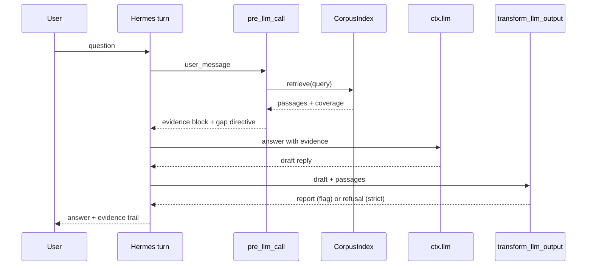

# Cite or Abstain — design

2026-11-04 · Hermes Agent Plugin Hackathon entry

## 1. Problem

Hermes answers fluently over material it does not have. Every existing remedy is a
request: a skill says "cite your sources", a prompt says "if unsure, say so". A model
asked to police itself defends itself.

`cgp` and `transcript-forge` already implement the alternative — separate evaluation
from generation, then verify the output mechanically. This plugin moves that discipline
from a standalone CLI into the agent's turn loop, where it cannot be skipped.

## 2. Scope

**In scope**

- A dependency-free corpus index over configured roots (markdown, text, PDF text layer).
- The three-phase gated answering pipeline (`cgp`), driven by `ctx.llm` or a configured
  OpenAI-compatible endpoint.
- A mechanical claim gate (`transcript-forge`) over the finished reply: quoted spans must
  be verbatim, hard claims (numbers, dates, names, URLs, identifiers) must be supported
  by a retrieved passage.
- An evidence report per turn: which sentences map to which passages.
- Two tools, one slash command, one bundled skill.
- Audit mode: a second local model reviews the first model's answer independently.

**Out of scope for v1**

- Embeddings or a vector store. The thesis is that crude, mechanical signals beat
  self-assessment; adding a semantic layer is a different product.
- Fine-tuning.
- Desktop evidence pane (stretch goal, day 5 only if days 1–4 are green).
- Non-text corpora beyond the PDF text layer.

## 3. Admission constraints

- Public repo, MIT, catalog entry pinned to a full 40-character SHA.
- No core overrides, no prototype patching, no `eval`/`new Function`, no `sys.modules` writes.
- Secrets only through `agent.secret_scope.get_secret()`.
- `hermes plugins validate <path> --install-deps` must pass with zero failures.
- Fails closed under cron and unattended runs: never blocks on a human.
- README and PR carry a disclosure section: what it reads, where it writes, what it sends.

## 4. Architecture

Four units, each testable without Hermes.

| Unit | Responsibility | Depends on |
|---|---|---|
| `coa/corpus.py` | Build and query the index. Returns `Passage` objects with path, line range, text, score. | stdlib |
| `coa/pipeline.py` | Three phases + overlap gate. Returns `RunResult` (confidence, answer, limitations, abstained). | corpus, llm adapter |
| `coa/claimgate.py` | Extract quotes and hard claims from an answer, match against passages, emit `Report`. | stdlib |
| `__init__.py` | `register(ctx)`: tools, hooks, command, skill. | Hermes plugin API |

### 4.1 `CorpusIndex`

```python
class CorpusIndex:
    def __init__(self, roots: list[Path], db_path: Path): ...
    def build(self, force: bool = False) -> int: ...      # returns documents indexed
    def retrieve(self, query: str, k: int = 4) -> list[Passage]: ...
    def stats(self) -> dict: ...
```

- SQLite (stdlib `sqlite3`) at `plugin_data_dir()/index.db`, one row per passage.
- Inverted term table; BM25 scoring computed in Python.
- Word-form folding: same `related()` prefix rule as `cgp.confidence` (4-char floor).
- Incremental: a document is re-indexed when its `mtime` or size changed.
- Caps: 2 MB per file, 4,000 files, 200 passages per document. Skips binaries by NUL
  byte sniff, skips `.git`, `node_modules`, `.venv`.
- PDF text layer via `pdftotext` if present; skipped cleanly otherwise.

`Passage` is a dataclass: `doc_id`, `path`, `start_line`, `text`, `score`.

### 4.2 `GatePipeline`

Adapted from `cgp.pipeline.orchestrator`, retriever and llm injected:

```python
def run(question, index, llm, domain="research", strictness="flag") -> RunResult
```

- Phase 1 rates confidence over the initially retrieved passages.
- Phase 2 runs only when the gate is not `high`; the model names targets, the index
  retrieves them.
- **Re-gate on the combined context** — the non-decorative step.
- Phase 3 is skipped entirely at `low`; the run is marked `abstained` with the model's
  reasons as limitations and the retrieval targets as recommendations.
- `llm` is `Callable[[str, str], str]`. Default adapter calls `ctx.llm`; a config option
  points at an OpenAI-compatible endpoint instead (the Spark).
- Prompt sets reuse `cgp.domains` verbatim: `research`, `code_review`, `debugging`,
  `system_ops`, `content_creation`.

`RunResult` carries `phases` so the evidence report can show what actually happened,
not a summary of it.

### 4.3 `ClaimGate`

```python
def check(answer: str, passages: list[Passage]) -> Report
```

Two classes of finding, deliberately different in severity:

- **Quotes** (`"…"`, `“…”`, ≥ 8 chars): must appear verbatim in a passage after
  whitespace and curly-quote normalization. A miss is a `violation`. Reconstructed
  quotes are the most damaging thing an answer can contain.
- **Hard claims**: numbers with units or percent, ISO/US dates, URLs, backticked
  identifiers, and runs of two or more capitalized words that are not sentence-initial.
  A miss is a `violation` in strict mode and an `unsupported` finding in flag mode.
- **Prose claims** are reported as `soft`: sentence-level lexical overlap with the best
  passage, below threshold. Never blocks. Paraphrase is legitimate; flagging it as
  fabrication would make the plugin unusable.

`Report` = `{violations, unsupported, supported: [(sentence, [passage_ids])], coverage}`.

### 4.4 Hermes surfaces

| Surface | Name | Behavior |
|---|---|---|
| `pre_llm_call` | evidence injection | Retrieves for the user message; injects a compact evidence block (≤ 6,000 chars) plus, when the corpus is thin, an explicit "the corpus does not cover X — name what is missing" directive. Skips turns that are not questions. |
| `transform_llm_output` | claim gate | `flag` mode: returns the answer with an appended evidence report. `strict` mode: `hold_stream=True`, and a violation replaces the answer with a refusal. |
| tool | `corpus_ask` | Runs the full pipeline; returns JSON with `abstained`, `confidence`, `answer`, `limitations`, `citations`. |
| tool | `evidence_report` | Re-runs the gate over the last answer and returns the support map. |
| command | `/ground` | `off` / `flag` / `strict` for the session. |
| skill | `confidence-gated-pipeline` | The procedure, shipped with the plugin via `ctx.register_skill`. |

## 5. Data flow



## 6. Policies

- **Default strictness: `flag`.** Streaming stays intact; the gate annotates. `strict` is
  opt-in per session or per config.
- **Unattended runs** (cron, gateway, kanban workers): always `flag`; never block, never
  wait for a human.
- **Latency budget**: retrieval ≤ 100 ms on a 4,000-file corpus. Phase 2 only when the
  gate says so, and at most 2 extra retrievals.
- **Caching**: retrieval cached per `(query_hash, index_mtime)`.
- **Token budget**: injected evidence capped at 6,000 chars, passages capped at 1,200
  chars each, best-first.
- **Corpus silence is not an error**: it produces an abstention, not a block.

## 7. Failure modes and responses

| Failure | Response |
|---|---|
| Corpus empty or unreadable | Tools return `{"error": ...}`; hooks no-op. Never fabricate. |
| `ctx.llm` unavailable | Hooks no-op; tools return error JSON. |
| Model echoes the `[high\|medium\|low]` template | `parse_confidence` already rejects the literal echo; falls through to the heuristic. |
| Claim gate false positive on paraphrase | Prose claims are soft-only. Hard claims are narrow by construction. |
| Gate would block in an unattended run | Downgraded to flag. |
| Index build overruns | Bounded by file/passage caps; build runs on a supervised task. |

## 8. Testing

- Unit tests per module, target 40+.
- Golden corpus: documents with known answers, documents with known *absences*.
- Adversarial fixtures: invented quote, invented figure, a legitimate paraphrase that must
  **pass**, a template echo, an empty corpus.
- Integration: run inside a real Hermes session and assert the hook output and the tool
  JSON shape.
- CI: unittest on 3.10 and 3.12, plus `hermes plugins validate --install-deps`.

## 9. Week plan

| Day | Work | Exit criterion |
|---|---|---|
| 1 | `gh` install + auth, repo create, scaffold, manifest, `validate` green | `hermes plugins validate` passes on an empty plugin |
| 2 | `corpus.py` + index tests | 4,000-file index builds < 5 s; retrieval < 100 ms |
| 3 | `pipeline.py` + gate tests | Abstention reproduced on the bundled absent-topic fixtures |
| 4 | `claimgate.py` + adversarial fixtures | Invented quote and invented figure both caught; paraphrase passes |
| 5 | Wire hooks/tools/command/skill into a live session | End-to-end run in Hermes with a real corpus |
| 6 | Audit mode, README, disclosure, screenshots, catalog PR | PR open, validate green at the pinned SHA |
| 7 | Demo video, X post, Typeform | Both links submitted |

## 10. Open decisions

1. Repo: new public `cite-or-abstain` with vendored engines (default), vs. `cgp` itself
   becoming the plugin repo.
2. Strictness default: `flag` (default) vs. `strict`.
3. Audit mode in v1 (default: yes) vs. deferred.
4. Which corpus the demo indexes: a curated subset of the vault, or the bundled example
   corpus.
